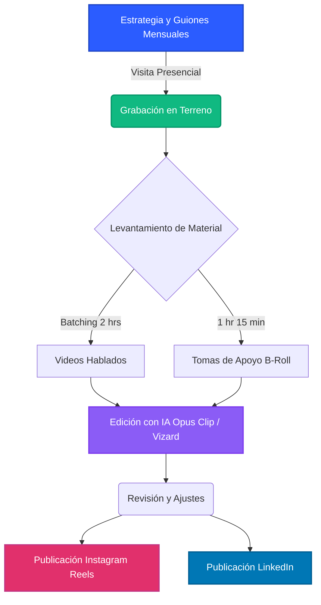

# Flujo de Trabajo (Producción y Marketing)

A continuación se detalla el ecosistema visual y el proceso de trabajo desde que se diseña la estrategia hasta que el contenido está publicado en las redes de Francisco Inmobiliaria.

### Explicación del Ecosistema

1. **Estrategia y Guiones:** Se definen los temas del mes basados en los dolores del cliente (compra en blanco, créditos, etc.).
2. **Terreno:** Se dedican 4 horas para recolectar TODO el contenido visual necesario.
3. **Inteligencia Artificial:** Se automatiza el proceso de edición (recortes, subtítulos automáticos, emojis y encuadre) utilizando herramientas de IA, ahorrando horas de trabajo manual.
4. **Distribución:** El contenido final se distribuye en formatos nativos verticales tanto para Instagram como para el público más corporativo en LinkedIn.
