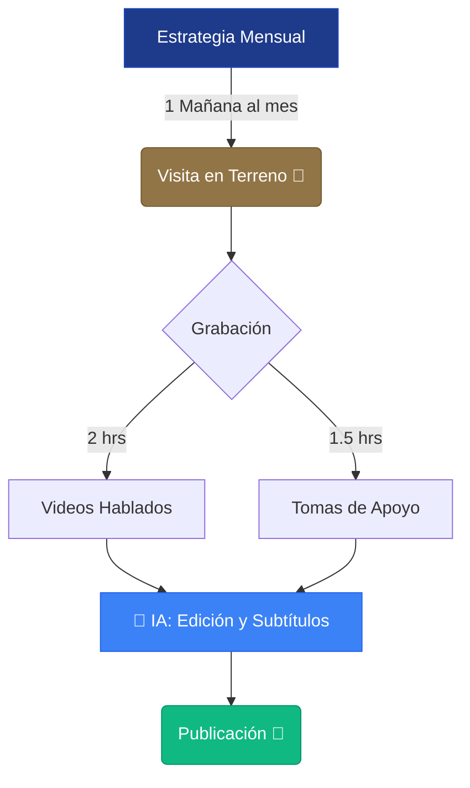

# 🚀 Resumen Ejecutivo

**Francisco Inmobiliaria - Estrategia Digital**

Bienvenido a tu portal de contenidos. Aquí encontrarás todo lo necesario para transformar tu conocimiento inmobiliario en un motor de ventas digital.

### 🎯 Objetivo Principal
Posicionarte como el **agente referente y de confianza** en Constructora Fundamenta, educando a tus clientes para derribar sus miedos (créditos, compra en blanco) y captando *leads* altamente calificados.

---

### 📊 Tu Ecosistema de Producción (El Gráfico)

Este es el modelo de trabajo que ejecutaremos cada mes para lograr visibilidad total con el mínimo de tu tiempo (solo 4 horas al mes):

### ⏱️ Tu Compromiso de Tiempo
- **1 sola visita presencial al mes (4 horas).**
- Nosotros nos encargamos del resto: Guiones, Edición (con IA) y Estrategia.

### 📂 ¿Qué hay en este portal?
Usa el menú lateral para navegar por tus documentos:
1. **Propuesta Comercial:** Los detalles del servicio y tarifas.
2. **Estrategia Digital:** Los pilares de qué y cómo publicaremos.
3. **Guía Visual:** Los colores y el tono de tu marca personal.
4. **Calendario y Guiones:** Lo que debes decir frente a la cámara.
